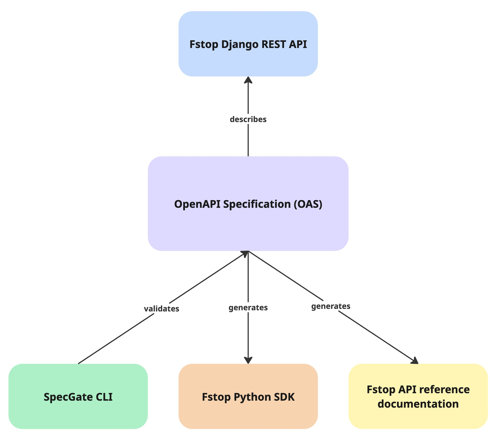

# Beyond the Docs

Beyond the Docs is a hands-on learning project where I built an ecosystem of developer tools to explore the relationship between APIs, OpenAPI, SDKs, developer tooling, and documentation.

The ecosystem includes:

- **[SpecGate](https://github.com/itsdeannat/specgate)** — A Go CLI that enforces OpenAPI specification readiness
- **[Fstop](https://github.com/itsdeannat/fstop)** — A Django REST API for a fictional photography platform
- **[Fstop Python SDK](https://github.com/itsdeannat/fstop-python-sdk)** — An automatically generated SDK based on Fstop's OpenAPI specification

The project started with a question:

**What could I learn about developer documentation by actually building the tools I document?**

## The ecosystem 

</img>

The OpenAPI specification sits at the center of the ecosystem. It describes the Fstop API, provides input for SDK generation, and gives SpecGate something to validate.

Visit [Beyond the Docs](https://beyond-the-docs.netlify.app/) on Netlify to learn more!

## Deployment status

